<!-- ================================================================ -->
<!-- AMRIT PRAKASH | GITHUB PROFILE README -->
<!-- ================================================================ -->

<div align="center">

  <a href="https://github.com/iamamritjha">
    
  </a>

  <br />

  <a href="https://linkedin.com/in/amrit-prakash-33b557257">
    
  </a>
  <a href="https://github.com/iamamritjha">
    
  </a>
  <a href="https://instagram.com/iamamritjha">
    
  </a>
  <a href="https://amritprakash.netlify.app/">
    
  </a>

  <br /><br />

  

</div>

## 🍷 About Me

```text
Software Engineer & Full-Stack Developer
Focused on useful software, web security, and resilient architectures.
```

- 👋 Hi, I'm **Amrit Prakash** — [@iamamritjha](https://github.com/iamamritjha).
- 🎯 **My philosophy:** Build useful software that creates real-world value and positive impact for society.
- 🚀 **Currently building:** LifeLedger, a personal health intelligence platform for organizing medical records and health timelines.
- 🛡️ **Cybersecurity:** Interested in web application security, defensive engineering, and secure system design.
- 🧩 **Problem solving:** Developing my foundations in Data Structures and Algorithms.
- 🌐 **Portfolio:** [amritprakash.netlify.app](https://amritprakash.netlify.app/)

<div align="center">
  
</div>

## 🚀 Featured Project

### 🏥 LifeLedger — Personal Health Intelligence Platform

**Live Demo:** [lifeledger-health.vercel.app](https://lifeledger-health.vercel.app/)

A digital health management platform designed to organize medical records, appointments, and prescriptions in one place.

**Project highlights**

- **Health records:** Organize and access medical documents and health information.
- **Authentication and access control:** Structured authentication and role-based permissions for patient and provider workflows.
- **Security:** Backend security measures include Helmet security headers and API rate limiting.
- **Modern interface:** Responsive web experience built with Next.js and Tailwind CSS.
- **Document processing:** Support for medical document uploads and PDF parsing.

**Tech stack**


**Explore LifeLedger**

- 🌐 [Live application](https://lifeledger-health.vercel.app/)
- 💻 [Frontend source code](https://github.com/iamamritjha/LifeLedger_Frontend)
- ⚙️ [Backend source code](https://github.com/iamamritjha/LifeLedger_Backend)

<div align="center">
  
</div>

## 🐍 GitHub Contribution Activity

<div align="center">
  <picture>
    <source media="(prefers-color-scheme: dark)" srcset="https://raw.githubusercontent.com/iamamritjha/iamamritjha/output/github-contribution-grid-snake-dark.svg" />
    <source media="(prefers-color-scheme: light)" srcset="https://raw.githubusercontent.com/iamamritjha/iamamritjha/output/github-contribution-grid-snake.svg" />
    
  </picture>

  <sub><em>Contribution animation generated through GitHub Actions.</em></sub>
</div>

<div align="center">
  
</div>

## 📊 GitHub Statistics

<div align="center">
  <a href="https://github.com/iamamritjha">
    
  </a>
  <br />
  <a href="https://github.com/iamamritjha">
    
  </a>
</div>

<div align="center">
  
</div>

## 🛠️ Technical Focus & Skills

| Domain | Technologies |
|---|---|
| **Languages** | JavaScript, TypeScript, Python, C++, Java, SQL |
| **Frontend** | Next.js, React, Tailwind CSS, HTML5, CSS3 |
| **Backend & APIs** | Node.js, Express.js, REST APIs, Authentication, RBAC |
| **Databases** | MongoDB, MySQL |
| **Tools** | Git, GitHub, Postman |
| **Core Engineering** | Data Structures and Algorithms, OOP, DBMS, Operating Systems |
| **Interests** | Web Security, Secure System Design, Full-Stack Development |

<div align="center">
  
</div>

## 🤝 Let's Collaborate & Connect

I'm interested in discussing full-stack development, software engineering opportunities, open-source projects, and cybersecurity initiatives.

- 💬 **Collaborate on:** Web application security, full-stack systems, and useful software.
- 💼 **LinkedIn:** [Amrit Prakash](https://linkedin.com/in/amrit-prakash-33b557257)
- 🐙 **GitHub:** [@iamamritjha](https://github.com/iamamritjha)
- 📸 **Instagram:** [@iamamritjha](https://instagram.com/iamamritjha)
- 🌐 **Portfolio:** [amritprakash.netlify.app](https://amritprakash.netlify.app/)

<div align="center">
  <br />
  
</div>
